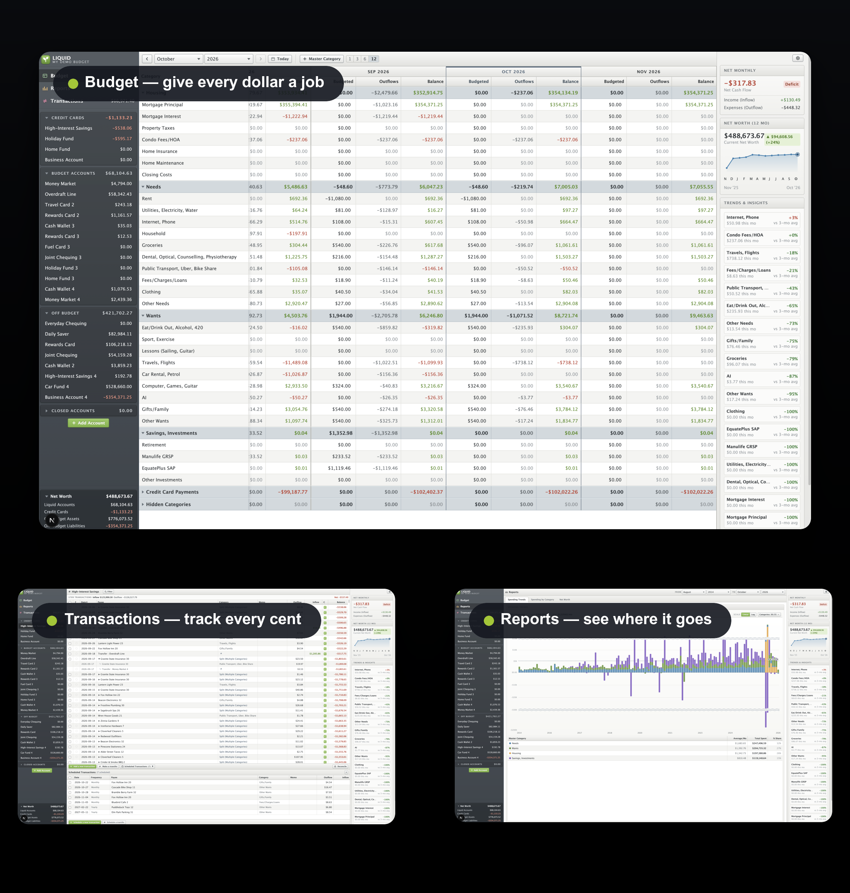

# Liquid Budget

**Your money, your machine.** A fast, local-first envelope budgeting app — give every dollar a job, track spending against your plan, and keep your data on your own computer. Miss YNAB4? Import your `.y4backup` and feel right at home.

## Why you'll like it

- 🧧 **True envelope budgeting** — assign money to categories each month, carry leftovers forward, and spot overspending at a glance.
- 📥 **YNAB4-friendly** — imports `.y4backup` and CSV files, so years of history come with you.
- 🔒 **Local-first & private** — everything lives in a SQLite file on your disk. No account, no cloud, no subscription.
- 📊 **Reports that answer questions** — spending by category, long-term trends, net worth, and expense breakdowns.
- ⚡ **Built for speed** — global search, bulk payee renames with auto-rename rules, split transactions, linked transfers.
- 🤖 **Optional AI assist** — payee rename suggestions via any OpenAI-compatible API (your key, your choice — off by default).

## What you can do

- **Plan each month**: budget by category, roll balances forward, see overspending instantly.
- **Track accounts**: record transactions, split one payment across categories, link transfers between accounts.
- **Manage payees**: rename many at once, set rules to rename them automatically.
- **Automate repeats**: schedule bills and income, preview future transactions.
- **Reconcile**: match records against bank statements and lock reconciled amounts.
- **Remove duplicates**: find possible duplicates and merge them safely.
- **Protect your data**: take full snapshots, restore when needed, and run integrity checks that prove balances are correct.
- **Change the look**: pick from built-in color themes.

## Start the app

1. Install Node.js 20 or newer.
2. Run `yarn install` to install dependencies.
3. Run `yarn build` to build all packages.
4. Run `yarn db:migrate` to prepare the database.
5. Run `yarn dev` to start the app.
6. Open `http://localhost:3000` in your browser.

Import your data from the import screens in the app (`.y4backup` or CSV).

> **Want AI rename suggestions?** Copy `apps/web/.env.example` to `apps/web/.env.local` and set `LLM_API_KEY` + `LLM_MODEL`. Any OpenAI-compatible endpoint works, including local ones.

## Useful commands

- `yarn dev` — start the app for development.
- `yarn test` — run all unit and component tests.
- `yarn e2e` — run end-to-end tests in a browser.
- `yarn typecheck` — check types in all packages.
- `yarn db:reset` — delete the local database and start again. This step destroys data.

## Project layout

- `apps/web` — the Next.js host. It holds routes and API handlers.
- `packages/logic` — budget rules and calculations. It has no database access.
- `packages/server` — the database, migrations, imports, exports, and snapshots.
- `packages/ui` — all screens and components.
- `packages/theme` — color themes and design tokens.

## Your data

The app stores data in `budget.db` in the project root. This file stays on your computer. Git does not track it. Make snapshots to keep copies of important states.
