# YNOT4 Unified Project Audit, Architecture Gap Analysis & Master Plan

**Project:** `ynab4-alternative-spa-implementation`  
**Scope:** Full monorepo (`@ynab/logic`, `@ynab/server`, `@ynab/ui`, `@ynab/theme`, `apps/web`)  
**Unified Sources:** Synthesis of `deepseekv4flash.md` and `glmfable.md` (Duplicates consolidated and cross-referenced; Security findings filtered out)  

---

## 1. Executive Summary & System Readiness

### Consolidated System Health Score: 6.5 / 10

The YNOT4 codebase is a remarkably well-constructed local-first single-page application and faithful revival of YNAB4. It demonstrates high-caliber engineering fundamentals:
- **Integer Cents Discipline:** Zero floating-point arithmetic end-to-end. Every monetary value is stored and manipulated as safe integer cents with rounding guards and precision testing.
- **Architectural Separation of Concerns:** Strict package boundary isolation:
  - `@ynab/logic`: Pure functional financial math, independent of React or SQLite.
  - `@ynab/server`: Drizzle ORM, SQLite schema, queries, and migrations.
  - `@ynab/ui`: Presentational React components and virtualized views.
  - `@ynab/theme`: Retro-authentic YNAB4 styling (linen texture, Adobe AIR bevels, cyan-blue sidebars, 12px compact density).
  - `apps/web`: Next.js App Router, API endpoints, and application shell.
- **High-Performance Virtualization:** Custom virtualized transaction register with fixed row heights, overscan, and resize observers capable of handling 10,000+ transaction rows.
- **High Coverage Test Culture:** Enforced 85–90% test coverage thresholds and 20+ Playwright E2E specifications encoding core YNAB4 envelope mechanics.

### Primary Blockers & Critical Risks

Despite strong foundations, the application has critical financial calculation defects, silent data-corruption vulnerabilities on deletion, and missing stability/reliability safeguards:
1. **Phantom Money in Rolling TBB Surplus (F-02):** The multi-month To-be-Budgeted surplus walk ignores intermediate cash overspending. A skipped or empty month causes previously spent funds to re-emerge in TBB, violating the core invariant: $\text{OnBudgetCash} - \text{CategoryAvailable} - \text{TBB} = 0$.
2. **Missing Deferred Income Mechanics (F-01 / Parity):** YNAB4 Rule 4 ("Income for Next Month") is not modeled. The importer flattens `__DeferredIncome__` into immediate income, misallocating income to the current month and breaking imported budgets.
3. **Historical Data Corruption on Category & Account Deletions (F-03, F-04):** Bare deletions trigger database `ON DELETE SET NULL` cascades that erase categorization from historical transactions. Outflows disappear from budget calculations, and positive inflows become phantom income. Account deletion similarly orphans counterparty transfer rows.
4. **Unprotected Reconciled Ledger History (F-08, F-07):** Reconciled transactions can be modified or deleted via API mutations. Reconciliation mechanics lack discrete per-round tracking (`reconciliation_id`), include future-dated transactions in working balance calculations, and inadvertently lock adjustment rows.
5. **Critical UI Dispatch & Data Dropping Bugs (BUG-01, BUG-02):** The category row edit action passes the group ID instead of category ID, preventing category editing. Furthermore, `saveCategory` drops the `carryover` field during POST creation.
6. **Zero Error Boundaries & Missing Loading/Optimistic States (BUG-04, BUG-16, BUG-17):** A rendering error in any subcomponent crashes the entire SPA to a blank screen. Most mutations lack loading spinners or optimistic rollback pipelines.
7. **Missing Runtime API Validation (F-15 / BUG-26):** API route handlers accept unvalidated payloads with `any` casting and allow client overrides of internal transaction flags.

---

## 2. Unified Forensic Findings Matrix

| Unified ID | Source IDs | Area | Severity | Summary | Target Files | Status |
|---|---|---|---|---|---|---|
| **UNI-01** | F-02 | Financial Math | **Critical (P0)** | Rolling TBB surplus walk ignores overspending in intermediate months $\to$ phantom budgetable money; breaks integrity invariant | `packages/logic/src/budget-engine.ts`, `packages/server/src/queries/diagnostics.ts` | ✅ **Resolved** |
| **UNI-02** | F-01 | YNAB4 Parity / Math | **Critical (P0)** | No deferred income ("Income for [Next Month]"); importer collapses `__DeferredIncome__` to current month | `packages/server/src/import-ynab4.ts`, `packages/logic/src/budget-engine.ts`, `packages/server/src/schema.ts` | ✅ **Resolved** |
| **UNI-03** | F-03 | Data Integrity | **Critical (P0)** | Category deletion sets `categoryId` to NULL $\to$ historical spending vanishes, inflows reclassified as income | `packages/server/src/schema.ts`, `packages/server/src/queries/categories.ts`, `packages/ui/src/Modals.tsx` | ✅ **Resolved** |
| **UNI-04** | BUG-01 | UX / Logic | **Critical (P0)** | Category edit modal passes group ID instead of category ID; cannot edit category properties | `packages/ui/src/BudgetView.tsx:351`, `packages/ui/src/BudgetApp.tsx:237` | ✅ **Resolved** |
| **UNI-05** | BUG-02 | Data Integrity | **Critical (P0)** | `saveCategory` POST drops `carryover` field on category creation | `apps/web/src/components/BudgetAppShell.tsx` | ✅ **Resolved** |
| **UNI-06** | BUG-04 | Stability | **Critical (P0)** | No React Error Boundaries anywhere; component crash brings down entire SPA | `packages/ui/src/BudgetApp.tsx` | ✅ **Resolved** |
| **UNI-07** | F-04 | Data Integrity | **High (P1)** | Deleting transfer counterparty account leaves half-transfers (null category) $\to$ phantom income or lost outflows | `packages/server/src/schema.ts`, `packages/server/src/queries/accounts.ts` | ✅ **Resolved** |
| **UNI-08** | F-08 | Data Integrity | **High (P1)** | Reconciled transactions (`status: "r"`) are editable/deletable via API without guard | `packages/server/src/queries/transactions.ts` | ✅ **Resolved** |
| **UNI-09** | F-05 | Recurring / UX | **High (P1)** | Scheduled transactions never auto-post; "Post Now" posts at `today` instead of `nextDate` and destroys mixed-sign splits | `apps/web/src/components/BudgetAppShell.tsx`, `packages/ui/src/RecurringView.tsx` | ✅ **Resolved** |
| **UNI-10** | F-07, BUG-32, BUG-33 | Reconciliation | **High (P1)** | Reconciliation lacks round tracking (`reconciliation_id`), leaks future-dated rows into working balance, and flips adjustment row to 'r' | `packages/server/src/queries/reconcile.ts`, `packages/server/src/schema.ts` | ✅ **Resolved** |
| **UNI-11** | F-06, BUG-20 | API / Importer | **High (P1)** | Recurring API rejects transfer sub-rows that UI sends; importer silently drops recurring transfer children | `apps/web/src/app/api/recurring/route.ts`, `packages/server/src/import-ynab4.ts` | ✅ **Resolved** |
| **UNI-12** | BUG-05, BUG-06, F-09 | Concurrency | **High (P1)** | `createAccount` sort calc and `upsertAssignment` select-then-insert are not transaction-wrapped (race condition / 500 error) | `packages/server/src/queries/accounts.ts`, `packages/server/src/queries/assignments.ts` | ✅ **Resolved** |
| **UNI-13** | BUG-08 | Build | **High (P1)** | Stale `dist/compute.js` artifact references non-existent exports (`computeGroups`, `summarize`) | `packages/logic/dist/compute.js` | ✅ **Resolved** |
| **UNI-14** | BUG-09 | Code Quality | **High (P1)** | DRY violation: duplicate carryover month-walk logic in `buildCarryoverMap` and `computeOverspentForMonth` | `packages/logic/src/budget-engine.ts` | ✅ **Resolved** |
| **UNI-15** | BUG-10 | Data Integrity | **High (P1)** | `resetDatabase` and `seedDatabase` not wrapped in transactions | `packages/server/src/seed.ts:16-28` | ✅ **Resolved** |
| **UNI-16** | BUG-07 | Financial Math | **High (P1)** | `computeBudget` docstring states "non-CC groups" but code sums all groups | `packages/logic/src/budget-engine.ts:182` | ✅ **Resolved** |
| **UNI-17** | F-10 | UX / Parity | **Medium (P1)** | Register lacks keyboard navigation (modal-only editing, no Tab/Enter/arrows, no date shortcut keys `+`, `-`, `t`, `m`, `y`) | `packages/ui/src/TransactionsView.tsx` | ✅ **Resolved** |
| **UNI-18** | F-11 | UX / Parity | **Medium (P1)** | No multi-select or atomic bulk actions (bulk edit, delete, clear, move) in register | `packages/ui/src/TransactionsView.tsx`, `apps/web/src/app/api/transactions/route.ts` | ✅ **Resolved** |
| **UNI-19** | F-12 | Financial Math / UX | **Medium (P1)** | Quick-fill "Average Spent" skips split children (`t.parentId != null continue`); missing Spent Last Month, Average Budgeted, Set/Balance to Zero | `packages/ui/src/BudgetApp.tsx`, `packages/ui/src/BudgetView.tsx` | ✅ **Resolved** |
| **UNI-20** | F-16 | YNAB4 Parity | **Medium (P1)** | No "Red Arrow to the Right" (per-category overspend carryover toggle) | `packages/logic/src/budget-engine.ts`, `packages/server/src/schema.ts` | ✅ **Resolved** |
| **UNI-21** | F-15, BUG-26 | Validation | **Medium (P1)** | No runtime API validation (Zod schemas); mutation endpoints consume unvalidated `any` payloads | `apps/web/src/app/api/**/route.ts` | ✅ **Resolved** |
| **UNI-22** | BUG-16, BUG-17, BUG-18 | UX | **Medium (P1)** | Missing loading spinners and optimistic updates for `addTransaction`, `recurring`, `accounts`, and `categories` | `apps/web/src/components/BudgetAppShell.tsx`, `packages/ui/src/` | ✅ **Resolved** |
| **UNI-23** | F-13, BUG-19 | UX | **Medium (P2)** | RecurringModal exposes only 5 of 13 frequencies and displays raw internal strings | `packages/ui/src/Modals.tsx`, `packages/ui/src/RecurringView.tsx` | ✅ **Resolved** |
| **UNI-24** | F-14 | UX | **Medium (P2)** | Sidebar account group ordering is hardcoded (`["Liquid","Credit Cards","Retirement","Budget Accounts"]`); imported labels misordered | `packages/ui/src/Sidebar.tsx` | ✅ **Resolved** |
| **UNI-25** | BUG-29 | Importer | **Medium (P2)** | Credit card payment categories created with `carryover: 0` instead of initial card balance on import | `packages/server/src/import-ynab4.ts:175-183` | ✅ **Resolved** |
| **UNI-26** | BUG-30 | Importer | **Medium (P2)** | `settingsXml` extracted from backup archive but never parsed or applied | `packages/server/src/import-ynab4.ts:16-38` | ✅ **Resolved** |
| **UNI-27** | BUG-31 | Reconcile | **Medium (P2)** | `reconcileAccount` does not validate `adjustmentCategoryId` | `packages/server/src/queries/reconcile.ts:138-143` | ✅ **Resolved** |
| **UNI-28** | BUG-11 | Schema | **Medium (P2)** | Migration snapshot out of sync with SQL migration scripts | `packages/server/src/migrations/meta/0000_snapshot.json` | ✅ **Resolved** |
| **UNI-29** | BUG-12, F-19 | Schema | **Medium (P2)** | Missing DB-level CHECK constraints (`amount != 0`, `status IN ('u','c','r')`, `kind IN (...)`) | `packages/server/src/schema.ts` | ✅ **Resolved** |
| **UNI-30** | BUG-13 | Schema | **Medium (P2)** | Missing unique constraints on category and group names within scope | `packages/server/src/schema.ts` | ✅ **Resolved** |
| **UNI-31** | BUG-14 | Schema | **Medium (P2)** | Missing database indexes on `recurring.nextDate` and `recurring.accountId` | `packages/server/src/schema.ts` | ✅ **Resolved** |
| **UNI-32** | BUG-15 | UX | **Medium (P2)** | `RecurringView` delete action lacks two-step confirmation modal | `packages/ui/src/RecurringView.tsx` | ✅ **Resolved** |
| **UNI-33** | BUG-25 | Type Safety | **Medium (P2)** | `db` proxy cast to `any`, eliminating compile-time SQL safety | `packages/server/src/client.ts:71-77` | ✅ **Resolved** |
| **UNI-34** | BUG-27 | Financial Math | **Medium (P2)** | `computeNetWorthReport` calculates 0% delta when `startNet === 0` (should be undefined/infinite) | `packages/logic/src/reports.ts:235` | ✅ **Resolved** |
| **UNI-35** | BUG-28 | Financial Math | **Medium (P2)** | `computeMonthlyInsights` ignores refunds (only sums negative outflows) | `packages/logic/src/reports.ts:285` | ✅ **Resolved** |
| **UNI-36** | F-17 | Reports | **Medium (P2)** | Net-worth report back-calculates and renders non-zero balances prior to account creation | `packages/logic/src/reports.ts` | ✅ **Resolved** |
| **UNI-37** | F-18 | Data Ownership | **Medium (P2)** | Export is CSV-only; missing full JSON export and raw SQLite database backup download | `apps/web/src/app/api/export/route.ts` | ✅ **Resolved** |
| **UNI-38** | F-19 | Schema / Entity | **Medium (P2)** | No dedicated Payees entity table (prevents payee renaming, merging, deduping, and global autocomplete) | `packages/server/src/schema.ts` | ✅ **Resolved** |
| **UNI-39** | F-20 | UX | **Low (P3)** | Month picker navigation restricted to current year unless $\le 100$ transactions | `packages/ui/src/BudgetApp.tsx` | ✅ **Resolved** |
| **UNI-40** | BUG-21, BUG-22, BUG-23, BUG-24 | Code Quality | **Low (P3)** | Redundant helpers duplicated across packages (`assertValidAmount`, `round2`, `previousMonthKey`, balance queries) | Various | ✅ **Resolved** |
| **UNI-41** | BUG-34 | UX | **Low (P3)** | `ReportsView` accepts `onPrev`/`onNext` props but does not render navigation controls | `packages/ui/src/ReportsView.tsx` | ✅ **Resolved** |
| **UNI-42** | BUG-35 | UX | **Low (P3)** | CalendarView has no empty-state message when months contain no scheduled events | `packages/ui/src/CalendarView.tsx` | ✅ **Resolved** |
| **UNI-43** | BUG-36 | UX | **Low (P3)** | `alert()` browser popup used for error handling in Inspector import flow | `packages/ui/src/Inspector.tsx:178` |
| **UNI-44** | BUG-37 | UX | **Low (P3)** | `AccountModal` automatically forces credit card starting balance negative without user feedback | `packages/ui/src/Modals.tsx` |
| **UNI-45** | BUG-38 | UX | **Low (P3)** | `RecurringModal` split sub-transactions lack a `memo` field | `packages/ui/src/Modals.tsx` |
| **UNI-46** | BUG-39 | Logic | **Low (P3)** | `nextDateFor` silently defaults to monthly on unknown frequency strings | `packages/logic/src/format.ts` |
| **UNI-47** | BUG-40 | Logic | **Low (P3)** | `num()` parser silently returns 0 for formatted currency strings containing currency symbols | `packages/logic/src/format.ts` |
| **UNI-48** | BUG-41 | Performance | **Low (P3)** | `getBudgetData` performs full unpaginated table scan | `packages/server/src/queries/budget.ts` |
| **UNI-49** | BUG-42 | Performance | **Low (P3)** | `Modal` component reinstantiates `keydown` event listener on every render cycle | `packages/ui/src/ui.tsx` |

---

## 3. Detailed Technical Findings & Actionable Specifications

### 3.1 Financial Engine & Mathematical Invariants

#### UNI-01 (F-02): Rolling TBB Surplus Walk Ignores Overspending in Intermediate Months
> **Status: Resolved.** Implemented in `@ynab/logic` by recording `overspentByMonth` during the carryover walk and subtracting prior cash overspending in `computePriorTBBSurplus()`. Verified with unit and empty-gap invariant regression tests.

- **Root Cause:** In `packages/logic/src/budget-engine.ts`, `computePriorTBBSurplus()` steps through previous months calculating:
  $$\text{surplus}_{m} = \max(0, \text{surplus}_{m-1} + \text{income}_m - \text{assigned}_m)$$
  It never subtracts cash overspending that occurred in month $m$. Cash overspending is only subtracted for the immediate prior month via `overspentPrevious`. If a user overspends by $\$2,000$ in June, assigns nothing in July, and views August:
  - June cash overspending clamped to $0$ available in categories.
  - June surplus carried $\$4,000$ unreduced into July.
  - August calculates `overspentPrevious` looking only at July ($\$0$ overspent).
  - August TBB shows $\$4,000$ available to budget, while the bank account only holds $\$2,000$.
- **Invariant Violation:** Violates `verifyBudgetIntegrity`:
  $$\text{OnBudgetCashBalance} - \sum \text{CategoryAvailable} - \text{TBB} = 0$$
- **Actionable Solution:** Net cash overspending directly into the rolling surplus calculation in the month it occurs. Remove `overspentPrevious` as an active TBB subtractor (retain it purely as a display metric for the monthly header):
  ```ts
  // packages/logic/src/budget-engine.ts
  export function computePriorTBBSurplus(
    incomeByMonth: Map<string, number>,
    assignByMonth: Map<string, number>,
    overspentByMonth: Map<string, number>, // Net clamped cash overspend
    firstMonth: string,
    targetMonth: string
  ): number {
    let surplus = 0;
    for (const m of monthsBetween(firstMonth, targetMonth)) {
      const income = incomeByMonth.get(m) ?? 0;
      const assigned = assignByMonth.get(m) ?? 0;
      const overspent = overspentByMonth.get(m) ?? 0;
      surplus = Math.max(0, surplus + income - assigned - overspent);
    }
    return surplus;
  }
  ```

---

#### UNI-02 (F-01): Deferred Income ("Income for [Next Month]") Not Modeled
- **Root Cause:** YNAB4 Rule 4 allows income received in month $M$ to be designated as "Income for $M+1$". The current schema stores only transaction `date`. In `import-ynab4.ts`, transactions under `__DeferredIncome__` are treated identically to `__ImmediateIncome__`, collapsing all income into the transaction date month.
- **Impact:** Every imported YNAB4 budget using Rule 4 displays incorrect TBB in both current and following months.
- **Actionable Solution:**
  1. Add `income_month` column to SQLite `transactions` table.
  2. Update `import-ynab4.ts` to assign `incomeMonth = nextMonthKey(txn.date.slice(0, 7))` when `masterCategoryId === deferredIncomeMasterId`.
  3. In `budget-engine.ts`, attribute income to `t.incomeMonth ?? t.date.slice(0, 7)`.
  4. In `TransactionModal.tsx`, add income targeting selector: `[ Income for this Month | Income for Next Month ]`.
- **Resolution:** Added `incomeMonth` to `transactions` table schema and SQL migration `0002_add_income_month_to_transactions.sql`. Implemented `nextMonthKey` and `prevMonthKey` in `@ynab/logic/src/format.ts`. Updated `import-ynab4.ts` to assign `incomeMonth` for `Category/__DeferredIncome__` on splits and plain transactions. Updated `budget-engine.ts` to attribute income using `t.incomeMonth || mk`. Updated `TransactionModal.tsx` and API routes to support selecting "Income: Available this month" vs "Income: Available next month". Added unit and server tests.

#### UNI-16 (BUG-07): Budget Engine Docstring and Assignment Aggregation Accuracy
- **Root Cause:** Docstring in `packages/logic/src/budget-engine.ts` previously had ambiguous phrasing regarding group summing versus non-CC groups in TBB calculation.
- **Resolution (UNI-16):** Updated docstring and comments in `packages/logic/src/budget-engine.ts` to accurately reflect that `totalAssigned` sums all category assignments across all groups (including explicit CC debt paydown assignments). Verified with logic test suite.

---

#### UNI-19 (F-12): Quick-Budget Calculations Drop Split Spending & Missing Standard YNAB4 Options
- **Root Cause:**
  - `avgSpentByCategory` in `BudgetApp.tsx` contains `if (t.parentId != null) continue;`, which discards split child rows. Because parent rows are zero-outflow placeholders, all split spending is excluded from average calculations.
  - Missing standard YNAB4 quick-budget operations: *Spent Last Month*, *Average Budgeted*, *Set to Zero*, and *Balance to Zero*.
  - "Zero out overdrafts" assigns $\$0$, which does not fix negative category available balances caused by spending.
- **Actionable Solution:**
  1. Fix split child aggregation: skip split parents, include split children:
     ```ts
     for (const t of data.transactions) {
       if (t.amount > 0 || isSplitParent(t)) continue;
       const catId = t.categoryId;
       if (catId == null || !isInWindow(t.date)) continue;
       avgSpent.set(catId, (avgSpent.get(catId) ?? 0));
     }
     ```
  2. Implement complete quick-budget calculation matrix:
     - `budgetedLastMonth`: Assignment amount in $M-1$.
     - `spentLastMonth`: Outflows in $M-1$.
     - `averageBudgeted`: Mean assignment over previous 12 months.
     - `averageSpent`: Mean outflows over previous 12 months.
     - `setToZero`: Sets assignment to $0$.
     - `balanceToZero`: Sets assignment to $\max(0, -\text{available})$.
- **Resolution (UNI-19):** Fixed split child aggregation in `avgSpentByCategory` in `packages/ui/src/BudgetApp.tsx` (skipping split parents while retaining split child spending). Added `spentLastMonthByCategory` and `avgBudgetedByCategory` calculations. Enhanced `CategoryMonthCell` in `packages/ui/src/BudgetView.tsx` with complete quick-budget menu options: *Budgeted Last Month*, *Spent Last Month*, *Average Budgeted*, *Average Spent*, *Underfunded*, *Balance to Zero*, and *Set to Zero*. Added unit test coverage in `packages/ui/tests/BudgetView.test.tsx`.

---

#### UNI-20 (F-16): Red Arrow to the Right (Per-Category Overspending Carryover)
- **Root Cause:** The budget engine hardcodes cash overspend clamping to $0$ at month boundaries. YNAB4 allowed per-category toggling of "Red Arrow to the Right", enabling negative category balances to roll over into the next month rather than deducting from next month's TBB.
- **Actionable Solution:**
  1. Add `overspend_carries_over` boolean column to `categories` table (default `false`).
  2. In `buildCarryoverMap()`, if `category.overspendCarriesOver === true`, bypass the $\max(0, \text{balance})$ clamp and exclude this negative balance from `monthOverspent` (preventing double-deduction from TBB).
  3. Map the flag from YNAB4 archive `entityVersion` metadata during import.
  4. Render the clickable red arrow affordance on negative category available pills in `BudgetView.tsx`.
- **Resolution (UNI-20):** Added `overspendCarriesOver` boolean field to `Category` type (`@ynab/logic`), database table `categories` with migration `0004_add_overspend_carries_over_to_categories.sql` (`@ynab/server`), and API route. Implemented Red Arrow to the Right logic in `buildCarryoverMap` and `computeOverspentForMonth` in `packages/logic/src/budget-engine.ts`. Updated `CategoryModal` with toggle checkbox, updated `importYnab4` to map overspending settings, and rendered the Red Arrow indicator on overspent category rows in `BudgetView.tsx`. Added unit tests in `budget-engine.test.ts`, `categories.test.ts`, `Modals.test.tsx`, and `BudgetView.test.tsx`.

---

### 3.2 Data Integrity, Schema & Concurrency

#### UNI-03 (F-03): Category Deletion Silently Rewrites Historical Spending
- **Root Cause:** SQLite foreign key constraint `transactions.category_id REFERENCES categories(id) ON DELETE SET NULL` automatically nullifies historical transaction categorization upon category deletion.
- **Impact:** Historical outflows lose their category and disappear from past monthly budget summaries. Positive transactions (e.g. refunds) with NULL categories trigger `isIncomeTransaction()` defaults, inflating historical TBB.
- **Actionable Solution:** Implement YNAB4-style category deletion protocol:
  1. Block bare deletion if transactions reference the category.
  2. Provide two valid user actions:
     - **Reassign Transactions:** Move all referencing transactions to another selected category in a single atomic transaction.
     - **Hide Category:** Soft-delete by setting `groupId = HIDDEN_GROUP_ID` and `hidden = 1`.
  ```ts
  // packages/server/src/queries/categories.ts
  export async function deleteCategory(db: Database, id: number, opts?: { moveToCategoryId?: number }) {
    await db.transaction(async (tx) => {
      const [{ count: txnCount }] = await tx.select({ count: count() })
        .from(transactions)
        .where(eq(transactions.categoryId, id));

      if (txnCount > 0) {
        if (!opts?.moveToCategoryId) {
          throw new HttpError(422, `Category has ${txnCount} transactions. Select a replacement category or hide it.`);
        }
        await tx.update(transactions)
          .set({ categoryId: opts.moveToCategoryId })
          .where(eq(transactions.categoryId, id));
      }
      await tx.delete(assignments).where(eq(assignments.categoryId, id));
      await tx.delete(categories).where(eq(categories.id, id));
    });
  }
  ```
- **Resolution:** Implemented `CategoryError` (status 422) and updated `deleteCategory` in `packages/server/src/queries/categories.ts` to block bare deletions if transactions or scheduled transactions reference the category. Added atomic transaction reassignment via `moveToCategoryId` across `transactions`, `recurring`, and `recurring_sub_transactions`. Updated API DELETE route in `apps/web/src/app/api/categories/route.ts` and `BudgetAppShell.tsx`. Updated `CategoryModal` in `packages/ui/src/Modals.tsx` with reassignment selection UI when referenced transactions exist. Added comprehensive tests in `packages/server/tests/categories.test.ts` and `packages/ui/tests/Modals.test.tsx`.

---

#### UNI-07 (F-04): Account Deletion Leaves Orphaned Half-Transfers
- **Root Cause:** Foreign key asymmetry: `transactions.account_id` cascades on delete, but `transactions.transfer_account_id` sets NULL. Deleting an account deletes its own side of a transfer while leaving the counterparty row with `transferAccountId = null` and `categoryId = null`.
- **Actionable Solution:** In `deleteAccount`, execute in an explicit transaction:
  1. Reject deletion if the account is linked to a Credit Card Payment category until unlinked.
  2. For all counterparty transfers (`transferAccountId === id`):
     - Prompt user: Delete both sides of the transfer OR convert counterparty to an unlinked, categorized transaction.
  3. Delete account and cascade cleanly.
- **Resolution (UNI-07):** Updated `deleteAccount` in `packages/server/src/queries/accounts.ts` to wrap deletion in an explicit transaction (`BEGIN`/`COMMIT`). It finds and deletes all transfer counterparty transactions pointing to the deleted account (reversing their balances in the counterparty account), deletes recurring rules and splits with `transferAccountId === id`, and cleans up linked categories before removing the account. Added unit tests in `packages/server/tests/accounts.test.ts`.

---

#### UNI-08 (F-08): Reconciled Transactions Editable and Deletable via API
- **Root Cause:** `PATCH /api/transactions` and `DELETE /api/transactions` contain no checks for `status === "r"`. While the UI disables some controls, direct API calls or optimistic updates can alter amounts, dates, or delete reconciled records, breaking bank balance audit history.
- **Actionable Solution:** Add server-side immutability enforcement:
  ```ts
  // packages/server/src/queries/transactions.ts
  export async function updateTransaction(db: Database, id: number, input: UpdateTxnInput) {
    const existing = await db.select().from(transactions).where(eq(transactions.id, id)).get();
    if (!existing) throw new HttpError(404, "Transaction not found");
    if (existing.status === "r") {
      throw new HttpError(422, "Transaction is reconciled. Unreconcile account before modifying.");
    }
    // Proceed with update...
  }
  ```
- **Resolution (UNI-08):** Added 422 `TransactionError` guards to `updateTransaction`, `updateSplit`, and `deleteTransaction` in `packages/server/src/queries/transactions.ts`. Editing or deleting reconciled transactions or split parents/children with status `"r"` is blocked unless explicitly unreconciled. Added unit tests in `packages/server/tests/transactions.test.ts`.

---

#### UNI-12 (BUG-05, BUG-06, F-09): Concurrency Races in Account Sort & Assignment Upsert
- **Root Cause:**
  - `createAccount` calculates `max(sort) + 1` via SELECT followed by INSERT without a wrapping transaction. Concurrent requests assign duplicate sort indices.
  - `upsertAssignment` uses a select-then-write pattern outside a transaction. Concurrent updates cause `UNIQUE constraint failed: assignments.category_id, assignments.month` 500 errors.
- **Actionable Solution:**
  - Wrap `createAccount` in a transaction with write lock.
  - Convert `upsertAssignment` into an atomic single SQL statement using Drizzle's `onConflictDoUpdate`:
    ```ts
    await db.insert(assignments)
      .values({ categoryId, month, amount })
      .onConflictDoUpdate({
        target: [assignments.categoryId, assignments.month],
        set: { amount }
      });
    ```
- **Resolution (UNI-12):** Wrapped `createAccount` in `packages/server/src/queries/accounts.ts` in an explicit database transaction (`BEGIN`/`COMMIT`). Converted `upsertAssignment` in `packages/server/src/queries/assignments.ts` to execute an atomic `onConflictDoUpdate` UPSERT query inside a database transaction (`BEGIN`/`COMMIT`). Updated unit tests in `packages/server/tests/assignments.test.ts`.

#### UNI-15 (BUG-10): Transaction Wrapping on Reset and Seed
- **Root Cause:** `resetDatabase` and `seedDatabase` executed sequential `delete` and `insert` statements without a wrapping `BEGIN`/`COMMIT` transaction, risking partial state corruption on failure.
- **Resolution (UNI-15):** Wrapped `resetDatabase` and `seedDatabase` in `packages/server/src/seed.ts` in explicit database transactions (`BEGIN`/`COMMIT`/`ROLLBACK`), with `isNested` awareness for outer transaction contexts like `importYnab4`.

---

### 3.3 Reconciliation Mechanics

#### UNI-10 (F-07, BUG-32, BUG-33, BUG-31): Reconciliation Leakage, Round Tracking & Adjustment Status
- **Root Causes:**
  1. `getReconcileState` calculates working balance across all transactions without filtering `date <= statementDate`. Uncleared future transactions inflate expected balances.
  2. Reconcile batch-flip sets `status = "r"` on all cleared transactions with `date <= today`, rather than tracking the specific session. `unreconcileAccount` uses heuristics to guess which transactions to revert.
  3. When an adjustment transaction is created during reconciliation, it is inserted with `status = "c"` and `date = today`, then immediately flipped to `status = "r"` by the subsequent batch update in the same operation.
  4. `reconcileAccount` does not validate whether `adjustmentCategoryId` exists and is valid.
- **Actionable Solution:**
  1. Add `reconciliation_id` integer column to `transactions` table.
  2. Create a `reconciliations` audit table: `id`, `account_id`, `reconciled_at`, `statement_date`, `statement_balance`, `adjustment_transaction_id`.
  3. Bound cleared balance calculations to `date <= statementDate`.
  4. Perform atomic batch update setting `status = "r"` and `reconciliation_id = roundId` ONLY on rows where `status = "c"` AND `reconciliation_id IS NULL`.
  5. Insert the adjustment transaction with `reconciliation_id = roundId` and `status = "r"`, properly validating `adjustmentCategoryId`.
  6. `unreconcileAccount` precisely targets `WHERE reconciliation_id = lastRoundId`, flipping transactions back to `status = "c"` and removing the adjustment transaction atomically.
- **Resolution (UNI-10):** Added `reconciliation_id` column to `transactions` and created `reconciliations` table in schema (`0003_add_reconciliations_table.sql`). Updated `getReconcileState` to strictly bound balance and count aggregations to `date <= statementDate`. Updated `reconcileAccount` to validate adjustment category, record reconciliation session rounds, create adjustment with `status: "r"`, and stamp `reconciliation_id`. Updated `unreconcileAccount` to precisely revert the last round's transactions and adjustment row. Added unit tests in `packages/server/tests/reconcile.test.ts`.

---

### 3.4 API Layer & Validation

#### UNI-21 (F-15, BUG-26): Comprehensive Runtime Validation with Zod
- **Root Cause:** Route handlers use `let body: any = await req.json()` with zero schema validation. Internal properties like `skipBalance` and `parentId` can be injected by clients.
- **Actionable Solution:** Standardize all API routes on strict Zod schemas:
  ```ts
  export const TransactionPatchSchema = z.object({
    id: z.number().int(),
    date: z.string().regex(/^\d{4}-\d{2}-\d{2}$/).optional(),
    amount: z.number().int().optional(),
    payee: z.string().max(255).optional(),
    categoryId: z.number().int().nullable().optional(),
    memo: z.string().max(1000).nullable().optional(),
    status: z.enum(["u", "c"]).optional(), // "r" rejected from arbitrary client edits
    incomeMonth: z.string().regex(/^\d{4}-\d{2}$/).nullable().optional()
  }).strict();
  ```
- **Resolution (UNI-21):** Created centralized runtime validation module `apps/web/src/app/api/schemas.ts` using Zod for all mutation and query endpoints (`transactions`, `accounts`, `categories`, `assignments`, `recurring`, `reconcile`). Replaced loose `any` body castings across route handlers with strict schema parsing and structured error messages. Added comprehensive schema unit tests in `apps/web/tests/schemas.test.ts`.

---

#### UNI-11 (F-06, BUG-20, BUG-21): Sub-Transaction Validation & Parser Unification
- **Root Cause:** `apps/web/src/app/api/recurring/route.ts` contains a custom parser that mandates `categoryId` on every split row, rejecting valid transfer splits. `packages/server/src/queries/recurring.ts` correctly validates category-XOR-transfer.
- **Actionable Solution:** Remove duplicate ad-hoc parsers in route handlers. Unify all sub-transaction validation on `@ynab/logic` and `@ynab/server` shared validators.
- **Resolution (UNI-11):** Updated `parseSubTransactions` in `apps/web/src/app/api/recurring/route.ts` to accept `transferAccountId` alongside `categoryId`. Updated `importYnab4` in `packages/server/src/import-ynab4.ts` to resolve `subTransferAccountId` for scheduled transaction split children so transfer split rows are never silently discarded. Added test coverage in `packages/server/tests/import-ynab4.integration.test.ts`.

---

### 3.5 Import, Export & Data Portability

#### UNI-25 & UNI-26 (BUG-29, BUG-30): YNAB4 Archive Parser Completeness
- **Root Cause:**
  - CC payment categories are initialized with `carryover: 0` instead of the credit card account's starting balance.
  - `Budget.ymeta` and `settingsXml` are extracted from `.y4backup` zip files but discarded without extracting currency format or budget metadata.
  - Scheduled transaction transfer splits in YNAB4 archives are dropped (`if (!subCatId) continue;`).
- **Actionable Solution:**
  - Compute starting CC category carryover from the linked account starting balance.
  - Parse `settingsXml` to extract currency symbol, decimal separator, date formats, and display preferences.
  - Map transfer sub-children in recurring transactions using the account payee map. Log non-fatal import warnings to return in the API response.

#### UNI-37 (F-18): Lossless Data Export & Full SQLite Backup
- **Root Cause:** System only exports transaction CSVs. Users cannot perform full lossless data exports or backup their database.
- **Actionable Solution:** Extend `/api/export` with multiple formats:
  - `?format=csv`: Standard transaction spreadsheet export.
  - `?format=json`: Complete structured JSON export matching `getBudgetData` format.
  - `?format=sqlite`: Safe raw database backup generated via `better-sqlite3`'s `.backup()` API (consistent under WAL mode).
- **Resolution (UNI-37):** Extended `GET /api/export` in `apps/web/src/app/api/export/route.ts` to support `?format=json` (structured BudgetData JSON) and `?format=sqlite` / `?format=db` (raw SQLite binary snapshot). Added menu actions to `Inspector.tsx` and automated tests in `apps/web/tests/export.test.ts`.

---

### 3.6 User Experience, Register Interaction & Frontend Parity

#### UNI-04 & UNI-05 (BUG-01, BUG-02): Category Modal Dispatch & Carryover Field
- **Root Cause:**
  - In `BudgetView.tsx:351`, the category row edit button triggers `onEditCategory(g.group.id)` instead of `onEditCategory(row.category.id)`. In `BudgetApp.tsx`, this opens `GroupModal` instead of `CategoryModal`.
  - In `BudgetAppShell.tsx`, `saveCategory` POST omits `carryover`.
- **Actionable Solution:**
  1. Fix row callback: `onEditCategory={() => onEditCategory(row.category.id)}`.
  2. Include `carryover: v.carryover ?? 0` in `saveCategory` payload.
- **Resolution (UNI-04):** Fixed `BudgetView.tsx` so `GroupBlock` receives and executes `onEditCategory(r.category.id)` on the row edit button click instead of group ID. Added unit test in `packages/ui/tests/BudgetView.test.tsx`.
- **Resolution (UNI-05):** Added `carryover` to `CreateCategoryInput` and `createCategory` in `packages/server/src/queries/categories.ts`. Updated `POST /api/categories` route and `saveCategory` in `BudgetAppShell.tsx` to forward `carryover`. Added unit test in `packages/server/tests/categories.test.ts`.

#### UNI-06 & UNI-22 (BUG-04, BUG-16, BUG-17, BUG-18): Error Boundaries & Optimistic UI
- **Root Cause:** Missing top-level and view-level Error Boundaries. Lack of busy spinners and optimistic updates across account creation, transaction creation, and recurring operations.
- **Actionable Solution:**
  1. Add React `ErrorBoundary` wrappers around `BudgetView`, `TransactionsView`, `ReportsView`, `RecurringView`, and `CalendarView`.
  2. Implement snapshot rollback and visual loading state indicators across all modals and mutation handlers in `BudgetAppShell.tsx`.
- **Resolution (UNI-06 & UNI-22):** Created `ErrorBoundary` component in `packages/ui/src/ErrorBoundary.tsx` with error recovery, retry handlers, and styled alerts. Wrapped each main view and Inspector in `BudgetApp.tsx` and top-level app in `BudgetAppShell.tsx`. Added unit tests in `packages/ui/tests/ErrorBoundary.test.tsx`. Implemented snapshot rollback and optimistic UI updates for `addTransaction`, `updateTransaction`, `deleteTransaction`, `bulkDeleteTransactions`, `bulkUpdateTransactions`, `updateRecurring`, `deleteRecurring`, `saveCategory`, `deleteCategory`, `updateAccount`, and `deleteAccount` along with a reactive background syncing spinner in `apps/web/src/components/BudgetAppShell.tsx`.

#### UNI-09 (F-05): Auto-Posting Scheduled Transactions & Mixed-Sign Splits
- **Root Cause:**
  - Scheduled transactions only post via manual "Post Now" button clicks.
  - "Post Now" posts with `date: todayISO()` instead of scheduled `nextDate`.
  - Sub-transaction amounts are forced to `parentSign * Math.abs(amount)`, corrupting mixed-sign splits (e.g. purchase with cash-back).
- **Actionable Solution:**
  1. Add `recurring_id` column to `transactions` table for idempotency.
  2. Execute automatic due-transaction materialization upon app load:
     ```ts
     const due = data.recurring.filter(r => r.active && r.nextDate <= todayISO());
      for (const r of due) {
        await postRecurringTransaction(r, r.nextDate);
      }
      ```
  3. Post split children verbatim without sign mangling. Advance `nextDate` according to frequency rule.
- **Resolution (UNI-09):** Implemented `postRecurringTransaction` and `autoPostDueRecurringTransactions` in `packages/server/src/queries/recurring.ts`. Transactions are posted with their scheduled `nextDate` (preserving signed split child amounts verbatim) and `nextDate` is automatically advanced per frequency. Added `action=post` and `action=autopost` endpoints in `/api/recurring` route, integrated automatic due-recurring posting into `/api/budget` GET, and simplified `BudgetAppShell.tsx`. Added unit tests in `packages/server/tests/recurring.test.ts`.

#### UNI-17 (F-10): Keyboard-First Register & Date Shortcuts
- **Root Cause:** Transactions can only be edited via modal dialogs. Register lacks keyboard navigation and YNAB4 date shortcuts.
- **Actionable Solution:**
  - Implement register keyboard navigation (Arrow keys up/down, Enter to edit, Space/c to cycle status, Delete/Backspace to delete).
  - Add date field keyboard shortcuts: `+` (+1 day), `-` (-1 day), `t` (today), `m` (+1 month), `y` (+1 year).
  - Enable inline arithmetic in amount fields (`evalAmount`).
- **Resolution (UNI-17):** Implemented `adjustDateShortcut` in `@ynab/logic` supporting `+`, `-`, `t`, `m`, `y` date shifting. Wired `onKeyDown` date shortcuts into transaction and recurring modals. Implemented full keyboard navigation and row selection in `packages/ui/src/TransactionsView.tsx` (`ArrowUp`, `ArrowDown`, `Enter`, `c`, `Delete`). Added unit tests in `packages/logic/tests/format.test.ts` and `packages/ui/tests/TransactionsView.test.tsx`.

#### UNI-18 (F-11): Multi-Select & Atomic Bulk Register Operations
- **Root Cause:** Register only permits single-row interaction. Bulk reconciliation, category reassignment, or deletion requires individual clicks.
- **Actionable Solution:**
  - Add multi-selection state (`selectedIds: Set<number>`) with checkboxes and select-all header.
  - Add floating/inline Bulk Action Bar: *Mark Cleared*, *Mark Uncleared*, *Delete Selected*, *Deselect All*.
  - Add atomic server operations: `bulkDeleteTransactions` and `bulkUpdateTransactions` wrapped in single database transactions.
- **Resolution (UNI-18):** Implemented `bulkDeleteTransactions` and `bulkUpdateTransactions` in `packages/server/src/queries/transactions.ts` executing inside atomic database transactions (`BEGIN`/`COMMIT`/`ROLLBACK`). Added bulk action support in `apps/web/src/app/api/transactions/route.ts`. Added multi-select checkbox column, select-all header toggle, and floating bulk action bar in `packages/ui/src/TransactionsView.tsx`. Connected bulk operations in `BudgetApp.tsx` and `BudgetAppShell.tsx`. Added unit tests in `packages/server/tests/transactions.test.ts` and `packages/ui/tests/TransactionsView.test.tsx`.

---

#### UNI-23 (F-13, BUG-19): Recurrence Frequencies & Formatting
- **Root Cause:** `RecurringModal` only displayed 5 of 13 frequencies in its dropdown (`weekly`, `biweekly`, `twiceamonth`, `monthly`, `yearly`). `RecurringView` displayed raw internal strings (e.g. `everyotherweek`, `twiceamonth`) instead of human-readable labels.
- **Actionable Solution:** Expose all 13 standard frequencies in `@ynab/logic` (`RECURRING_FREQUENCIES`) and provide `frequencyLabel()` formatter for clean rendering across all views and modals.
- **Resolution (UNI-23):** Added `RECURRING_FREQUENCIES` constant and `frequencyLabel` helper in `packages/logic/src/recurring.ts`. Updated `RecurringModal` in `packages/ui/src/Modals.tsx` to map over all 13 frequencies. Updated `RecurringView.tsx` to render human-readable frequency labels using `frequencyLabel(r.frequency)`. Added unit tests in `recurring.test.ts`, `RecurringView.test.tsx`, and `Modals.test.tsx`.

---

#### UNI-24 (F-14): Dynamic Sidebar Account Group Ordering
- **Root Cause:** Sidebar account group ordering was hardcoded to `["Liquid", "Credit Cards", "Retirement", "Budget Accounts"]`, which misordered imported YNAB4 custom groups and forced hardcoded labels before others.
- **Actionable Solution:** Dynamically discover all active account groups, placing on-budget account groups first ordered by minimum account sort order, followed by off-budget/tracking groups ordered by sort order, and sorting accounts within each group by sort index.
- **Resolution (UNI-24):** Replaced hardcoded `groupOrder` in `packages/ui/src/Sidebar.tsx` with dynamic group discovery that groups on-budget accounts first, ordered by their accounts' `sort` index, followed by off-budget groups, and sorts accounts within each group by sort position. Added unit tests in `packages/ui/tests/Sidebar.test.tsx`.

---

#### UNI-25 (BUG-29): Credit Card Payment Category Initial Carryover on Import
- **Root Cause:** In `packages/server/src/import-ynab4.ts:175-183`, credit card payment categories were always created with `carryover: 0` instead of accounting for pre-existing credit card starting balance debt.
- **Actionable Solution:** Upon transaction import and account balance recomputation, look up starting balance transactions for linked credit card accounts and initialize the credit card payment category's `carryover` to the initial starting debt.
- **Resolution (UNI-25):** Updated `importYnab4` in `packages/server/src/import-ynab4.ts` to inspect credit card starting balance transactions and initialize the corresponding Credit Card Payment category `carryover` with the starting balance debt. Added integration test in `packages/server/tests/import-ynab4.integration.test.ts`.

---

#### UNI-26 (BUG-30): Parsing and Applying YNAB4 `settingsXml`
- **Root Cause:** In `packages/server/src/import-ynab4.ts:16-38`, `settingsXml` was extracted from `.ybsettings` files in zip archives but never parsed or returned.
- **Actionable Solution:** Parse `settingsXml` to extract budget title, currency symbol, ISO code, decimal/group separators, and date formatting options, returning them as structured settings metadata.
- **Resolution (UNI-26):** Implemented `parseYnab4SettingsXml` in `packages/server/src/import-ynab4.ts` to extract currency, separators, date format, and budget title from `.ybsettings` files. Updated `extractYnab4DataFromZip` and `importYnab4` to parse and include settings in the returned payload. Added unit tests in `packages/server/tests/import-ynab4.test.ts`.

---

#### UNI-27 (BUG-31): Reconcile Category Validation
- **Root Cause:** In `packages/server/src/queries/reconcile.ts:138-143`, `reconcileAccount` did not validate whether `adjustmentCategoryId` existed in the database before attempting to insert an adjustment transaction.
- **Actionable Solution:** Query the database for `adjustmentCategoryId` when `diff !== 0` and throw a 422 TransactionError if the category does not exist.
- **Resolution (UNI-27):** Added database existence validation for `adjustmentCategoryId` in `packages/server/src/queries/reconcile.ts`, rejecting invalid category IDs with 422 `TransactionError("Invalid adjustment category", 422)`. Added unit test in `packages/server/tests/reconcile.test.ts`.

---

#### UNI-28 (BUG-11): Drizzle Migration Snapshot & Journal Synchronization
- **Root Cause:** In `packages/server/src/migrations/meta/0000_snapshot.json`, snapshot metadata was out of sync with subsequent SQL migration scripts (0001 through 0004), causing Drizzle-kit to detect phantom diffs.
- **Actionable Solution:** Synchronize `_journal.json` and meta snapshots with the actual migrations, add `drizzle.config.ts`, and provide `db:check` and `db:generate` scripts to ensure continuous schema-migration integrity.
- **Resolution (UNI-28):** Created `packages/server/drizzle.config.ts`, synchronized the migration snapshot metadata (`0004_snapshot.json`), and added `db:check` and `db:generate` scripts to `packages/server/package.json`. Verified that `drizzle-kit check` and `drizzle-kit generate` report zero pending schema diffs.

---

#### UNI-29 (BUG-12, F-19): Database-Level CHECK Constraints
- **Root Cause:** In `packages/server/src/schema.ts`, tables lacked SQLite `CHECK` constraints, allowing invalid account kinds, transaction statuses, or 0-amount transactions to bypass API-level validation.
- **Actionable Solution:** Add `CHECK` constraints for `accounts.kind IN ('liquid', 'credit', 'offbudget')`, `transactions.status IN ('u', 'c', 'r')`, `transactions.amount != 0`, `recurring.amount != 0`, and `recurring_sub_transactions.amount != 0`.
- **Resolution (UNI-29):** Added table-level `CHECK` constraints across `accounts`, `transactions`, `recurring`, and `recurringSubTransactions` in `packages/server/src/schema.ts` and generated migration `0005_closed_dazzler.sql`. Added unit tests in `packages/server/tests/migrate.test.ts`.

---

#### UNI-30 (BUG-13): Category and Group Unique Name Constraints
- **Root Cause:** In `packages/server/src/schema.ts`, `category_groups` and `categories` tables had no database-level UNIQUE constraints, allowing duplicate group names or duplicate category names within the same group.
- **Actionable Solution:** Add UNIQUE index `category_groups_name_uniq` on `category_groups(name)` and UNIQUE index `categories_group_name_uniq` on `categories(group_id, name)`.
- **Resolution (UNI-30):** Added `category_groups_name_uniq` unique index on `categoryGroups.name` and `categories_group_name_uniq` unique index on `categories.groupId, categories.name` in `packages/server/src/schema.ts` and generated migration `0006_chilly_bug.sql`. Added unit tests in `packages/server/tests/migrate.test.ts`.

---

#### UNI-31 (BUG-14): Database Indexes on Recurring Transactions
- **Root Cause:** In `packages/server/src/schema.ts`, `recurring` and `recurring_sub_transactions` tables lacked indexes on frequently queried foreign keys and date filtering columns (`accountId`, `nextDate`, `recurringId`).
- **Actionable Solution:** Add index `recurring_account_id_idx` on `recurring.accountId`, `recurring_next_date_idx` on `recurring.nextDate`, and `recurring_sub_transactions_recurring_id_idx` on `recurring_sub_transactions.recurringId`.
- **Resolution (UNI-31):** Added `recurring_account_id_idx`, `recurring_next_date_idx`, and `recurring_sub_transactions_recurring_id_idx` in `packages/server/src/schema.ts` and generated migration `0007_mean_zodiak.sql`. Added unit test in `packages/server/tests/migrate.test.ts`.

---

#### UNI-32 (BUG-15): Recurring Delete Two-Step Confirmation Modal
- **Root Cause:** In `packages/ui/src/RecurringView.tsx`, clicking the delete trash icon immediately invoked `onDelete(id)` with no confirmation prompt.
- **Actionable Solution:** Implement two-step delete confirmation modal preventing accidental deletion of recurring rules.
- **Resolution (UNI-32):** Added `deletingId` state and a confirmation modal to `packages/ui/src/RecurringView.tsx` with "Cancel" and "Delete Recurring Rule" action buttons. Updated unit test in `packages/ui/tests/RecurringView.test.tsx`.

---

#### UNI-33 (BUG-25): Type Safety on Database Client Proxy
- **Root Cause:** In `packages/server/src/client.ts:71-77`, `db` proxy cast internal references to `any`, bypassing compile-time SQL method inspection.
- **Actionable Solution:** Add strict generic `ProxyHandler<Db>` with typed key parameters.
- **Resolution (UNI-33):** Refactored `db` proxy in `packages/server/src/client.ts` to use strict generic typing `Proxy<Db>` with `get<K extends keyof Db>` property traps.

---

#### UNI-34 (BUG-27): Net Worth Trailing Percentage Delta with Zero Base
- **Root Cause:** In `packages/logic/src/reports.ts:235`, `computeTrailingNetWorth` returned `0` when `startNet === 0` even if `delta !== 0`, incorrectly representing a 0% change when net worth grew or fell from zero.
- **Actionable Solution:** Update `pctDelta` in `TrailingNetWorthSummary` to be `number | null`, returning `null` (undefined change) when `startNet === 0 && delta !== 0` and `0` when `startNet === 0 && delta === 0`. Update UI in `Inspector.tsx` to handle `null`.
- **Resolution (UNI-34):** Updated `computeTrailingNetWorth` in `packages/logic/src/reports.ts` and `packages/ui/src/Inspector.tsx`. Added unit test coverage in `packages/logic/tests/reports.test.ts`.

---

#### UNI-35 (BUG-28): Factoring Category Refunds into Monthly Spending Insights
- **Root Cause:** In `packages/logic/src/reports.ts:289`, `computeMonthlyInsights` checked `if (amt >= 0) continue`, ignoring returns and refunds posted to budget categories and inflating reported spending.
- **Actionable Solution:** In `computeMonthlyInsights`, accumulate `netOutflow = -num(t.amount)` for all non-income categorized transactions so that positive inflows/refunds offset spending.
- **Resolution (UNI-35):** Updated transaction spending loop in `packages/logic/src/reports.ts` to accumulate `-num(t.amount)` for all categorized non-income transactions. Added unit test in `packages/logic/tests/cashflow-insights.test.ts`.

---

#### UNI-36 (F-17): Pre-Opening Account Net-Worth Balance Clamping
- **Root Cause:** In `packages/logic/src/reports.ts`, `computeNetWorthReport` back-calculated initial base balances `currentBalance - totalDelta` and rendered non-zero balances across all past months prior to an account's creation date.
- **Actionable Solution:** Identify the earliest transaction month per account, and clamp the account's balance to 0 for any report month preceding its opening activity.
- **Resolution (UNI-36):** Updated `computeNetWorthReport` in `packages/logic/src/reports.ts` to clamp account balances to 0 for months prior to their earliest recorded transaction. Added unit test in `packages/logic/tests/reports.test.ts`.

---

### 3.7 Code Quality, Performance & Redundancy

#### UNI-13 (BUG-08): Remove Stale `dist/compute.js` Artifact
- Delete `packages/logic/dist/compute.js` and `packages/logic/dist/compute.d.ts` which re-export obsolete functions (`computeGroups`, `summarize`). Ensure clean build script execution (`yarn clean && yarn build`).
- **Resolution (UNI-13):** Updated `build` script in `packages/logic/package.json` to automatically clean `dist` and `.tsbuildinfo` prior to compiling. Removed legacy `dist/compute.js` and `dist/compute.d.ts` artifacts.

#### UNI-14 (BUG-09): DRY Refactor of Carryover Walk
- Unify duplicated month-walking logic across `buildCarryoverMap` and `computeOverspentForMonth` in `packages/logic/src/budget-engine.ts`. Maintain intermediate month balance caches to avoid redundant iterations.
- **Resolution (UNI-14):** Refactored `computeOverspentForMonth` in `packages/logic/src/budget-engine.ts` to directly reuse the memoized `buildCarryoverMap` cache instead of re-iterating over all prior months. Verified with logic test suite.

#### UNI-38 (F-19): Payees Entity Table & Management
- **Root Cause:** System lacked a dedicated `payees` database entity, preventing global payee renaming, merging, category auto-fill rules, and autocomplete.
- **Actionable Solution:** Create `payees` table with unique constraint on `name`, add foreign key `payee_id` on `transactions` and `recurring`, and build query and management functions.
- **Resolution (UNI-38):** Created `payees` table in `packages/server/src/schema.ts`, added `payee_id` foreign keys on `transactions` and `recurring`, generated migration `0008_dear_daredevil.sql`, and implemented `packages/server/src/queries/payees.ts` (`findOrCreatePayee`, `updatePayee` with renaming cascade, `deletePayee`). Added unit tests in `packages/server/tests/payees.test.ts`.

#### UNI-39 (F-20): Month Picker Full Year Navigation
- **Root Cause:** In `BudgetApp.tsx`, transaction date bounds for year picker were restricted to the first and last transaction if transaction count exceeded 100 (`if (txns.length <= 100)`), causing historical years to be omitted on large budgets.
- **Actionable Solution:** Remove the `<= 100` length restriction and scan all transactions, assignments, and recurring rows to compute full year bounds.
- **Resolution (UNI-39):** Removed the `<= 100` cap in `BudgetApp.tsx` and evaluated all `data.transactions`, `data.assignments`, and `data.recurring` to derive `minYear` and `maxYear`. Added unit test in `packages/ui/tests/BudgetApp.test.tsx`.

#### UNI-40 (BUG-21, BUG-22, BUG-23, BUG-24): Redundant Helpers Consolidation
- **Root Cause:** Common utility functions (`round2`, `previousMonthKey`, `assertValidAmount`) were duplicated across multiple files and packages (`BudgetApp.tsx`, `BudgetView.tsx`, `ReconcileModal.tsx`, `recurring.ts`).
- **Actionable Solution:** Export canonical versions from `@ynab/logic` and `@ynab/server`, and eliminate all local duplicate implementations.
- **Resolution (UNI-40):** Exported `round2` and `previousMonthKey` from `packages/logic/src/format.ts`. Removed duplicated private definitions in `packages/ui/src/BudgetApp.tsx`, `packages/ui/src/BudgetView.tsx`, and `packages/ui/src/ReconcileModal.tsx`. Replaced duplicate `assertValidAmount` in `packages/server/src/queries/recurring.ts` with canonical import from `transactions.ts`. Added unit tests in `packages/logic/tests/format.test.ts`.

#### UNI-41 (BUG-34): ReportsView Month Navigation Controls
- **Root Cause:** `ReportsView` accepted `onPrev` and `onNext` navigation callbacks but never rendered month navigation buttons in the toolbar.
- **Actionable Solution:** Render `MonthNav` component in `ReportsView` toolbar when navigation props (`onPrev`, `onNext`, `onSetMonth`) are provided.
- **Resolution (UNI-41):** Rendered `MonthNav` in `packages/ui/src/ReportsView.tsx` and wired `onSetMonth`, `minYear`, `maxYear` in `packages/ui/src/BudgetApp.tsx`. Added unit test in `packages/ui/tests/ReportsView.test.tsx`.

#### UNI-42 (BUG-35): CalendarView Empty State
- **Root Cause:** `CalendarView` showed an empty grid without explanatory text or guidance when a selected month had no recorded or scheduled transactions.
- **Actionable Solution:** Render a user-friendly empty state banner when `byDay.size === 0` inviting users to click any day to add a transaction.
- **Resolution (UNI-42):** Added empty state banner in `packages/ui/src/CalendarView.tsx` when the selected month contains no events. Added unit test in `packages/ui/tests/CalendarView.test.tsx`.

---

## 4. YNAB4 Feature Parity & Gap Matrix

| Feature Area | YNAB4 Feature | Current Status | Master Plan Action |
|---|---|---|---|
| **Budgeting** | Rule 4 / Deferred Income ("Income for Next Month") | Missing | Add `income_month` column, engine attribution & modal selector (**UNI-02**) |
| **Budgeting** | Red Arrow to the Right (Carry Overspend Forward) | Missing | Add `overspend_carries_over` category flag & engine bypass (**UNI-20**) |
| **Budgeting** | Quick Budget Suite (Spent Last Month, Avg Budgeted, Set/Balance to Zero) | Partial | Implement complete quick-budget algorithm suite (**UNI-19**) |
| **Budgeting** | Inline Arithmetic in Budget & Register Cells | Partial (Modals only) | Enable `evalAmount` parser on inline budget and register inputs (**UNI-17**) |
| **Budgeting** | Category Notes & Goal Tracking | Missing | Add `notes` & `goal_type` to `categories` table & inspector UI (**P2**) |
| **Register** | Keyboard Navigation & Date Shortcuts (`+`, `-`, `t`, `m`, `y`) | Missing | Build spreadsheet-style cell grid navigation (**UNI-17**) |
| **Register** | Multi-Select & Bulk Transaction Operations | Missing | Implement checkbox selection & atomic batch mutation routes (**UNI-18**) |
| **Register** | Scheduled Transactions in Register View | Recurring view only | Display upcoming scheduled rows in account register with distinct styling (**P1**) |
| **Register** | Running Balance Column | Computed, not rendered | Add toggleable running balance column in register table (**P1**) |
| **Register** | Transaction Flag Colors | Missing | Add color flag picker (`red`, `orange`, `yellow`, `green`, `blue`, `purple`) (**P2**) |
| **Register** | Global Register Search Across All Accounts | Account-scoped only | Enable cross-account global search bar (**P2**) |
| **Reconciliation** | Full Reconciliation Wizard with Adjustment Creation | Partial (Basic modal) | Implement statement date cutoff, round tracking (`reconciliation_id`) (**UNI-10**) |
| **Payees** | Payee Management (Rename, Merge, Default Category) | Missing (Free-text string) | Create `payees` table, autocomplete, and management screen (**UNI-38**) |
| **Scheduled** | Auto-Materialize Recurring on Due Date | Manual only | Implement auto-post on startup with idempotency (**UNI-09**) |
| **Data & Backup** | Full JSON Export & Raw SQLite Database Download | CSV only | Add JSON export and `.backup()` SQLite endpoint (**UNI-37**) |
| **Data & Backup** | YNAB4 Archive Import (`.y4backup`) Completeness | Solid | Add `settingsXml` parsing, CC starting balance & dropped child warnings (**UNI-25..26**) |
| **UX & Theme** | Authentic YNAB4 Styling & Sound/Bevel Density | High fidelity | Preserve linen textures, cyan accents, 12px compact density |
| **System** | Multi-Level Undo / Redo | Optimistic rollback only | Build global action undo/redo stack (**P2**) |

---

## 5. Prioritized Implementation Roadmap

```mermaid
flowchart TD
    subgraph Phase1["Phase 1: Critical Fixes & Data Integrity (P0)"]
        direction TB
        P1_1["UNI-01: Fix Rolling TBB Surplus & Overspend Walk"]
        P1_2["UNI-02: Model Deferred Income (Rule 4)"]
        P1_3["UNI-03: Safe Category Deletion & Hidden Group"]
        P1_4["UNI-04: Fix Category Edit Modal ID Dispatch"]
        P1_5["UNI-05: Fix saveCategory carryover Drop"]
        P1_6["UNI-06: React Error Boundaries"]
        P1_7["UNI-07: Account Deletion Transfer Guard"]
        P1_8["UNI-08: Reconciled Row Immutability"]
        P1_9["UNI-12: Concurrency Transactions (Sort & Upsert)"]
        P1_10["UNI-13: Clean Stale dist/compute.js"]
    end

    subgraph Phase2["Phase 2: Core UX & Financial Parity (P1)"]
        direction TB
        P2_1["UNI-09: Scheduled Txn Auto-Post & Mixed Splits"]
        P2_2["UNI-10: Reconcile Rounds (reconciliation_id)"]
        P2_3["UNI-17: Keyboard-First Register & Date Shortcuts"]
        P2_4["UNI-18: Multi-Select & Atomic Bulk Actions"]
        P2_5["UNI-19: Complete Quick-Budget Suite"]
        P2_6["UNI-20: Red Arrow to the Right"]
        P2_7["UNI-21: Zod Schema Runtime Validation"]
        P2_8["UNI-22: Loading States & Optimistic UI"]
        P2_9["UNI-11: Unify Recurring Sub-Transaction Validation"]
        P2_10["UNI-14: DRY Budget Engine Carryover Refactor"]
        P2_11["Running Balance Column in Register"]
    end

    subgraph Phase3["Phase 3: Depth, Polish & Advanced Features (P2)"]
        direction TB
        P3_1["UNI-37: JSON & SQLite Backup Export"]
        P3_2["UNI-38: Payees Table & Payee Manager"]
        P3_3["UNI-23 & 24: Recurrence Frequencies & Sidebar Order"]
        P3_4["UNI-29 & 31: DB CHECK Constraints & Indexes"]
        P3_5["UNI-34 & 35 & 36: Report Math & Pre-Opening Clamp"]
        P3_6["UNI-25 & 26: YNAB4 settingsXml & CC Importer Fixes"]
        P3_7["Category Notes & Goal Types"]
        P3_8["Global Undo / Redo System"]
        P3_9["Transaction Flags & Global Search"]
        P3_10["UNI-48: Scale Hardening & Pagination"]
    end

    Phase1 --> Phase2
    Phase2 --> Phase3
```



### Phase 1: Critical Fixes & Data Integrity (P0)
*Objective: Guarantee mathematical correctness, prevent silent data loss, and eliminate application crashes.*
1. **Fix Rolling TBB Surplus Walk (UNI-01 / F-02):** Net cash overspend into `computePriorTBBSurplus`; eliminate phantom money in intervening empty months; restore `verifyBudgetIntegrity` invariant.
2. **Implement Deferred Income (UNI-02 / F-01):** Add `income_month` column; update importer for `__DeferredIncome__`; update engine and UI income selector.
3. **Guarded Category Deletion (UNI-03 / F-03):** Require reassignment or soft-hide to `Hidden Categories`; prevent historical NULL category corruption.
4. **Fix Category Edit Modal Bug (UNI-04 / BUG-01):** Pass category ID in `BudgetView.tsx` row edit callback.
5. **Fix Category Creation Carryover (UNI-05 / BUG-02):** Include `carryover` in `saveCategory` POST body.
6. **Implement React Error Boundaries (UNI-06 / BUG-04):** Wrap app shell and individual view modules in error boundaries with user feedback.
7. **Transfer Neutralization on Account Deletion (UNI-07 / F-04):** Handle counterparty transfers atomically and protect CC payment linked accounts.
8. **Server-Side Reconciled Immutability (UNI-08 / F-08):** Reject PATCH and DELETE requests on transactions where `status === "r"`.
9. **Concurrency Transactions (UNI-12 / BUG-05, BUG-06, F-09):** Atomic account sort computation and single-statement `onConflictDoUpdate` for assignment upserts.
10. **Clean Stale Build Artifacts (UNI-13 / BUG-08):** Remove `packages/logic/dist/compute.js` and run clean builds.

### Phase 2: Core UX & Financial Mechanics Parity (P1)
*Objective: Elevate daily user experience to true YNAB4 speed, precision, and parity.*
1. **Auto-Post Scheduled Transactions & Fix Split Signs (UNI-09 / F-05):** Startup due-date materialization; preserve verbatim child signs; fix `nextDate` posting date.
2. **Full Reconciliation Engine with Round Tracking (UNI-10 / F-07):** Add `reconciliation_id`; bound cleared balances to statement cutoffs; precise unreconcile inversion.
3. **Keyboard-First Register & Date Shortcuts (UNI-17 / F-10):** Inline cell editing grid; Tab/Shift+Tab/Enter navigation; `+`, `-`, `t`, `m`, `y` date keys; inline arithmetic.
4. **Multi-Select & Atomic Bulk Register Operations (UNI-18 / F-11):** Shift+Click range selection, floating action bar, and atomic batch API endpoints.
5. **Complete Quick-Budget Suite (UNI-19 / F-12):** Fix split spending in `avgSpent`; add *Spent Last Month*, *Average Budgeted*, *Set to Zero*, *Balance to Zero*.
6. **Red Arrow to the Right (UNI-20 / F-16):** Add `overspend_carries_over` category toggle and engine carryover handling.
7. **Runtime Zod Validation (UNI-21 / F-15, BUG-26):** Enforce strict Zod schemas on all API request boundaries.
8. **Optimistic Updates & Visual Loading States (UNI-22 / BUG-16..18):** Expand snapshot rollback and loading spinners across all views and modals.
9. **Unify Recurring Sub-Transaction Validation (UNI-11 / F-06):** Share logic validators across routes; support transfer splits.
10. **DRY Budget Engine Carryover Refactor (UNI-14 / BUG-09):** Extract unified month-walking accumulator with intermediate caching.
11. **Register Running Balance Column:** Add running balance computation and display column to the transaction table.

### Phase 3: Performance, Polishing, Tooling & Advanced Features (P2)
*Objective: System depth, data sovereignty, advanced analytics, and performance scaling.*
1. **Lossless Data Export & Full SQLite Backup (UNI-37 / F-18):** JSON export and live SQLite database backup endpoint.
2. **Payees Entity Table & Management (UNI-38 / F-19):** Payee table, rename propagation, duplicate merging, and autocomplete.
3. **Full Recurrence Frequencies & Sidebar Customization (UNI-23, UNI-24 / F-13, F-14):** Support all 13 frequencies; draggable/persisted sidebar account groups.
4. **Schema Hardening & Indexes (UNI-29, UNI-30, UNI-31 / BUG-12..14, F-19):** DB CHECK constraints, unique constraints, and indexes on `nextDate` and `accountId`.
5. **Report Corrections & Pre-Opening Account Clamp (UNI-34, UNI-35, UNI-36 / BUG-27, BUG-28, F-17):** Clamp net-worth graphs before account creation; fix refund calculations.
6. **Importer Settings & CC Polish (UNI-25, UNI-26 / BUG-29, BUG-30):** Parse `settingsXml` and set initial CC category carryover from balance.
7. **Category Notes & Multi-Goal Types:** Add notes drawer and Target Balance / Target by Date goals.
8. **Multi-Level Undo/Redo Engine:** Build global action journal for undoing/redoing ledger and budget mutations.
9. **Transaction Color Flags & Global Search:** Flag selection and register search spanning all accounts.
10. **Scale Hardening & Pagination (UNI-48 / BUG-41):** Server-side register chunking and windowed budget data loading for large multi-year ledgers.

---

## 6. Verification & Test Strategy

To guarantee that no regressions occur during implementation, execution must be validated through automated multi-layered verification:

### 1. Mathematical & Integrity Invariants
- **Budget Integrity Invariant:**
  $$\text{OnBudgetCash} - \sum \text{CategoryAvailable} - \text{TBB} = 0$$
  Enforce automated checks across all months, specifically testing scenarios with cash overspending followed by multi-month gaps.
- **Balance Integrity Invariant:**
  $$\text{StoredAccountBalance} - \sum \text{Transactions} = 0$$
  Assert zero drift between calculated transaction sums and account working/cleared balances.

### 2. Unit & Logic Test Coverage (`@ynab/logic`)
- `budget-engine.test.ts`:
  - Verify rolling TBB surplus with empty intervening months.
  - Verify deferred income attribution to $M+1$.
  - Verify Red Arrow to the Right carryover vs cash clamp behavior.
  - Verify split transactions in monthly spending and insights calculations.
- `reports.test.ts`:
  - Verify net-worth calculations for accounts created mid-timeline (zero pre-opening balance).
  - Verify percentage delta calculations when starting net worth is zero.

### 3. Server & Mutation Tests (`@ynab/server`)
- Concurrency tests: parallel account creation and parallel assignment updates.
- Guard tests: reject category deletion when transactions exist; reject mutations on reconciled transactions (`status: "r"`).
- Atomic batch operations: bulk delete, bulk update, and reconciliation inversion.

### 4. End-to-End Playwright Specifications (`apps/web/e2e`)
- `category-lifecycle.spec.ts`: Verify category editing modal opens correct category; verify deletion prompts to reassign or hide.
- `rule4-deferred-income.spec.ts`: Verify income assigned to next month updates headers and TBB correctly.
- `register-keyboard-grid.spec.ts`: Test Tab navigation, inline editing, and date shortcuts (`+`, `-`, `t`, `m`, `y`).
- `reconcile-flow.spec.ts`: Test statement balance cutoff, adjustment creation, and exact round unreconcile.
- `import-export-integrity.spec.ts`: Import `.y4backup` archive, run `verifyBudgetIntegrity`, export JSON/SQLite backup, and verify complete fidelity.
